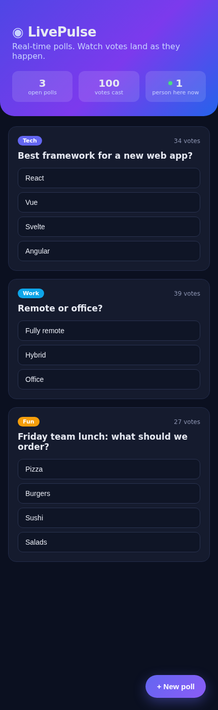
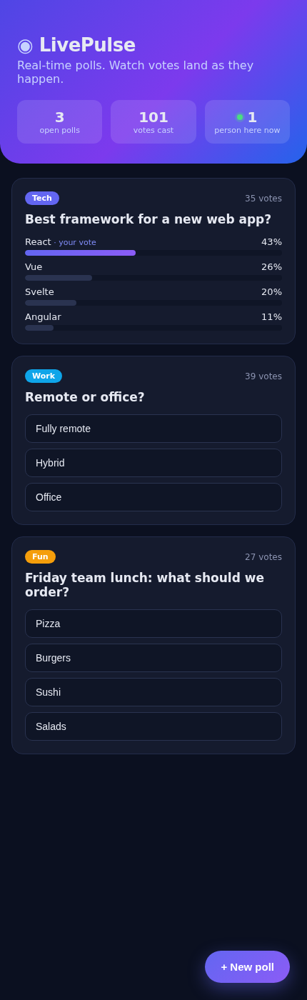
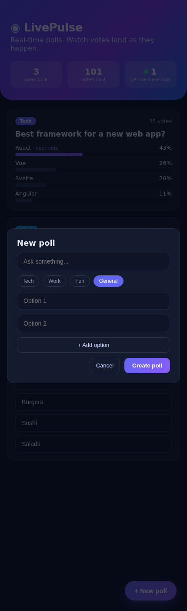

# LivePulse

A real-time polling app: create a poll, share the page, and watch votes
animate in live for everyone looking at it.

## Features

- Live results over WebSocket: votes, new polls and viewer presence
  update every open page instantly, no refresh.
- Create polls with a question, a category (Tech / Work / Fun / General)
  and 2-6 options, with validation on both client and server.
- One vote per poll per browser (remembered in localStorage), then the
  card flips to animated result bars with percentages and a "your vote"
  marker.
- Live header stats: open polls, total votes cast, and how many people
  are on the page right now (presence, with a pulsing live dot).
- Dark, gradient-branded UI with animated result bars and card
  transitions.
- In-memory store seeded with demo polls; the REST + WebSocket surface
  is designed so a database can drop in behind it.

## Tech stack

- Backend: Node.js + Express (REST) + ws (WebSocket), plain ES modules
- Frontend: React 18 + TypeScript + Vite
- Tests: node:test + the ws client (backend), Vitest + Testing Library
  (frontend)

## Run it

```bash
# backend on :4000 (serves the built frontend too)
cd server && npm install && npm start

# frontend dev server on :5173 (proxies /api and /ws), in another shell
cd web && npm install && npm run dev

# production build, then everything is served from :4000
cd web && npm run build
```

## Tests

```bash
cd server && npm test   # 5 tests: REST + live WebSocket broadcasts
cd web && npm test      # 6 tests: poll card, voting, poll creation form
```

## Screenshots




